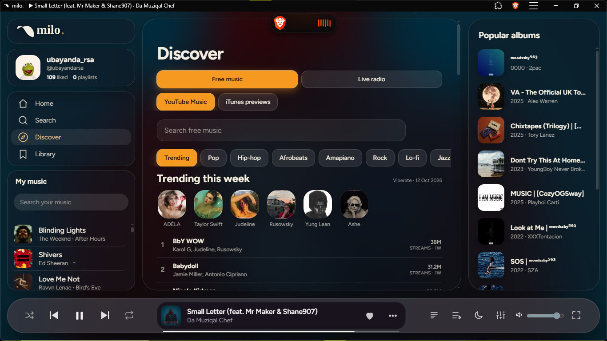
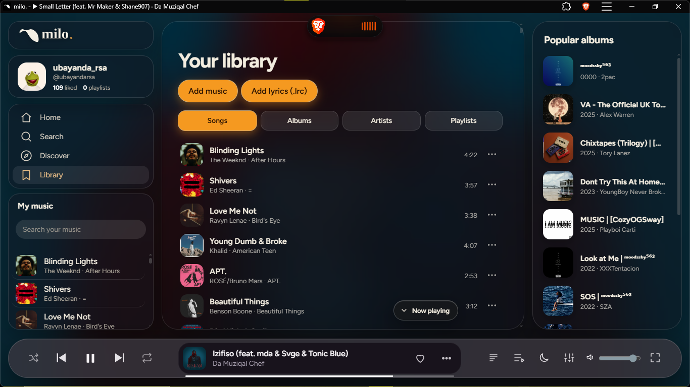

<div align="center">


# milo.

**A premium, single-file music player that lives in your browser.**
Your library, the YouTube Music catalogue, live radio and word-by-word karaoke lyrics, with no build step and no server.


[Live demo](https://claude.ai/artifact/LtVpb7FCy9LAnFfeNQknZr) · [Install](#-install) · [Features](#-features) · [Configure](#-configure) · [Smart TVs](#-smart-tvs)



</div>

---

## ✨ Features

| | |
|---|---|
| 🎧 **Your music** | Add your own files and they stay in the app's storage between launches. Open audio files with milo. straight from your desktop. |
| 🌐 **Stream** | YouTube Music catalogue, 30-second iTunes previews and live radio. |
| 🧠 **Music intelligence** | Autoplay queues songs like the one playing, using artist, genre, tempo, energy, what you like and what you skip. Tempo and energy are analysed on-device. When online it also uses similar artists from iTunes, Deezer and YouTube. Every song menu has **Start radio**. |
| 🎤 **Karaoke lyrics** | On desktop, Now Playing fills the current line word by word in time with the music. Lyrics come from SimpMusic Lyrics, LRCLIB and BetterLyrics (timed). |
| 🖥️ **Immersive desktop** | Full-bleed art (or the YouTube video) behind the player, spectrum visualiser, wide middle panel. |
| 📜 **Queue and lists** | The playing song is highlighted everywhere, with a jump pill to scroll back to it. Glass pop-ups throughout. |
| 📊 **YouTube extras** | SimpMusic weekly charts, SponsorBlock skips, Return YouTube Dislike counts. |
| ☁️ **Cloud sync** | Optional Supabase sync with row-level security, each person sees only their own data. |
| 👤 **Accounts** | Sign-up screen on launch, then your profile card and the terms (versioned, must be accepted). Playlists, likes, history and settings sync across devices. |
| 🤝 **Friends** | Add people by username, see their shared playlists and what they're listening to. Friends get the *song DNA* (title, artist, source link), never your files, and it opens by streaming. |
| 💬 **Disappearing chat** | 5 MB per chat, messages vanish after 24 hours, oldest are removed when the limit is reached. |
| 🌍 **Languages and data saver** | English, Zulu, Swahili, Afrikaans, French, Spanish, Portuguese, Hindi, Arabic (right-to-left), plus a data-light mode. |
| 🚗 **Car mode, lyric translation** | Big-button driving screen; translate lyrics line by line. |
| 📺 **Smart TV** | Samsung Tizen and LG webOS packages, TV mode switches on automatically. |

<div align="center">



</div>

## 📦 What's in the folder

```
milo-app/
├── index.html              # the whole app
├── manifest.webmanifest    # name, icons, shortcuts, file handling
├── sw.js                   # service worker (offline)
├── icons/                  # any, maskable, Apple touch, favicon, SVG
├── splash/                 # splash.jpg + iPhone/iPad startup images
├── supabase-setup.sql      # accounts, sync, friends, chat (run once)
├── vercel.json             # cache headers for Vercel
├── native/                 # Capacitor Android project (see NATIVE.md)
└── .github/workflows/      # builds the APK on GitHub
    docs/                   # README images
```

## 🚀 Install

An installable web app must be served over **https** (or `localhost`).

1. Put the whole folder on any static host: [Netlify Drop](https://app.netlify.com/drop), GitHub Pages, Cloudflare Pages or Vercel.
2. Open the https address, then:

| Device | How |
|---|---|
| Android (Chrome, Edge) | Menu → **Install app** |
| iPhone / iPad | Safari → Share → **Add to Home Screen** |
| Desktop Chrome / Edge | Install icon at the right of the address bar |

Try it locally first:

```bash
python3 -m http.server 8080   # then open http://localhost:8080
```

> **Updating:** after editing `index.html`, bump the version in `sw.js` (`milo-v79` → `milo-v78`) so installed copies refresh. An installed app may need one extra restart to pick it up.

For the Play Store, Microsoft Store or App Store, upload your hosted address to [pwabuilder.com](https://pwabuilder.com).

## 🔧 Configure

**Accounts, sync, friends and chat (Supabase)**
1. Run `supabase-setup.sql` once in the Supabase SQL editor. It creates the sync table, profiles, friends, shared data and chat, all with row-level security.
2. In Supabase > Authentication > Providers > Email, **turn off "Confirm email"** so people can go straight from sign-up to their profile card. (If it stays on, they must click the email link first.)
3. The Supabase anon key in `index.html` is meant to be public. Row-level security protects the data.
4. Have a lawyer review the terms text (`TERMS_HTML` in `index.html`) before a public launch. Bump `TERMS_V` when you change them to make everyone accept again.

**YouTube**
The YouTube Data API key in `index.html` is visible to anyone. In Google Cloud Console, restrict it to *YouTube Data API v3* and to your site's HTTP referrers so nobody else spends your quota.

> Hosted previews (like a shared claude.ai page) block outside connections. Cloud sync and YouTube work in the installed or self-hosted app.

## 📺 Smart TVs

Samsung Tizen and LG webOS packages live in `milo-tv/`; see `milo-tv/README-TV.txt`. TV mode turns on by itself in TV browsers, or use Profile → Insights & tools → TV mode, or add `?tv=1` to the address.

## 🛟 Troubleshooting

- **No Install option?** Open it from https or localhost, not from a file or a chat preview link. Profile → Install milo. tells you which case you're in.
- Keep `sw.js`, `manifest.webmanifest`, `icons/` and `splash/` next to `index.html`.
- **Android Chrome:** reload once after the first visit.
- **iPhone / iPad:** use Safari, not Chrome.

## 🙏 Credits

Inspired by [SimpMusic](https://github.com/maxrave-dev/SimpMusic) and used through public web APIs only; no SimpMusic code is bundled. Also uses LRCLIB, BetterLyrics, SponsorBlock, Return YouTube Dislike, iTunes, Deezer, Supabase and the YouTube IFrame and Data APIs.

Audius, Creative Commons (Openverse) and Internet Archive sources were removed. Songs saved earlier from them are dropped from Saved songs.

<div align="center">

Made with ♥ by **UBayanda**

</div>

## 📱 Native apps

milo. detects whether it runs in a browser, an installed web app, an Android WebView (Web2APK) or Capacitor, and turns on storage protection, back-button handling, screen-on while playing and the native share / save sheets where they exist. See [NATIVE.md](NATIVE.md) for the Capacitor setup and what still needs native code.
